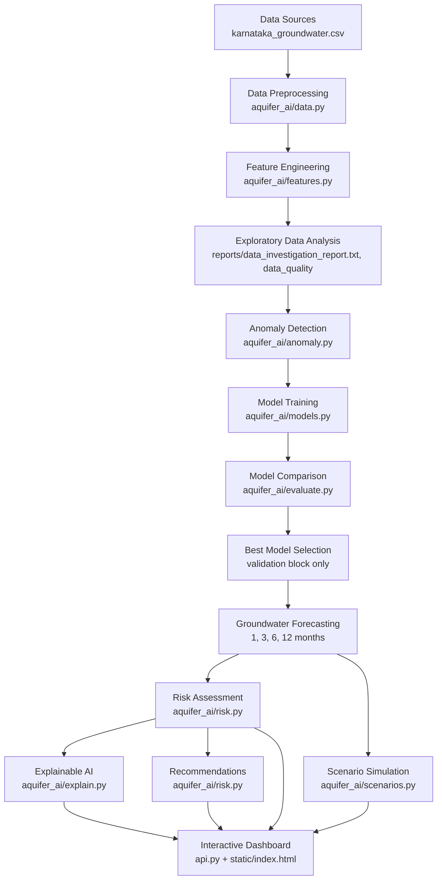
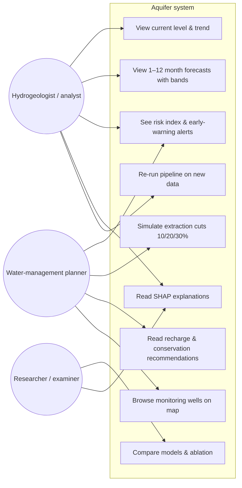

# Architecture, data flow and use cases

## 1. Pipeline architecture

The stages follow the architecture given in the project brief. Each stage maps to a module.

## 2. Data-flow diagram

```mermaid
flowchart LR
    subgraph Offline pipeline: run_pipeline.py
      R[(Raw CSV<br/>~45 MB, all stations)] --> P1[Clean one station<br/>monthly mean, interpolate, flag]
      P1 --> P2[Chronological split<br/>70 / 15 / 15]
      P2 --> P3[Tune & rank on validation]
      P3 --> P4[Refit on train+val<br/>score test]
      P4 --> P5[Refit on all data<br/>12-month forecast]
      P5 --> P6[Risk, alerts, recovery,<br/>health, SHAP, scenarios]
      P6 --> REP[(reports/*.csv, summary.json,<br/>figures/, models/*.joblib)]
    end
    subgraph Online service: uvicorn api:app
      REP --> API[FastAPI JSON endpoints]
      API --> UI[Browser dashboard]
      UI -- slider / cut % --> WI[/api/whatif recalculates<br/>from saved forecast/]
      WI --> UI
    end
```

## 3. Use-case diagram

## 4. Modules at a glance

| Module | Responsibility |
|---|---|
| `aquifer_ai/config.py` | All thresholds, weights and assumptions in one place |
| `aquifer_ai/data.py` | Load, clean, flag missing months, chronological split |
| `aquifer_ai/features.py` | Lag, rolling, change and calendar features (past values only) |
| `aquifer_ai/models.py` | Naive, seasonal naive, ARIMA, SARIMA, Random Forest, XGBoost, LSTM, GRU |
| `aquifer_ai/evaluate.py` | MAE, RMSE, MAPE, R², one-step and multi-horizon errors |
| `aquifer_ai/anomaly.py` | Sudden jumps, seasonal residuals, repeated values, Isolation Forest |
| `aquifer_ai/recovery.py` | Seasonal rise, response time, recession time, recharge ratio |
| `aquifer_ai/risk.py` | Groundwater Risk Index, early-warning alerts, recommendations |
| `aquifer_ai/health.py` | Aquifer Health Score (project-developed indicator) |
| `aquifer_ai/explain.py` | SHAP, permutation importance, partial dependence |
| `aquifer_ai/scenarios.py` | What-if extraction scenarios (assumption-driven) |
| `aquifer_ai/stations.py` | Latest reading per monitoring well for the map |
| `api.py` | FastAPI endpoints over the artifacts |
| `static/index.html` | Dashboard (Plotly, no build step) |
